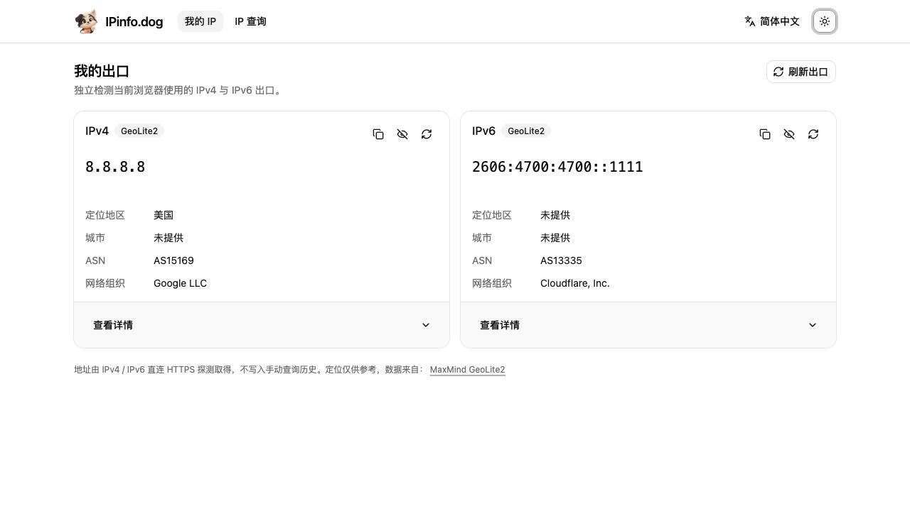
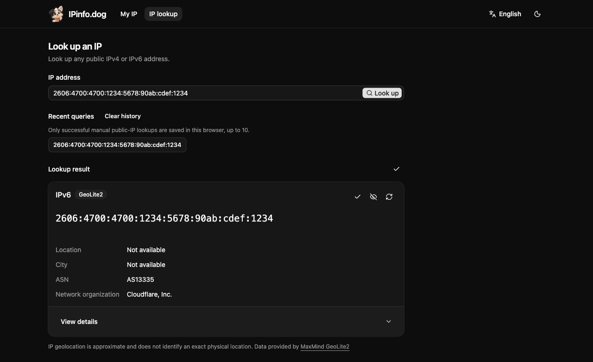

# M1 两页视觉确认

日期：2026-11-13。以下为当前应用的真实浏览器截图，保留 Neutral 黑白灰与已批准 Logo；不是旧原型。首页使用本地受控公共 DNS 示例地址，资料由实际 MMDB 返回，仅用于确认排版；公网真实出口验收单独记录。用户已于 2026-11-13 回复“接受这版视觉”。该结论来自用户反馈，工程 / 网络验收仍按独立证据记录。

## 首页

[浅色完整图](evidence/2026-11-13-home-light.png) · [深色完整图](evidence/2026-11-13-home-dark.png) · [手机 390px](evidence/2026-11-13-home-mobile.png)

## 独立 IP 查询

[浅色完整图](evidence/2026-11-13-query-light.png) · [深色完整图](evidence/2026-11-13-query-dark.png) · [320px 长 IPv6 / 详情](evidence/2026-11-13-query-320.png)

## 本次确认范围

两页布局、字号、密度、浅深色和手机效果是否接受。功能、实际网络、自动更新与工程测试由任务证据另行记录；截图里的缺失字段真实保留，不补造归属资料。
