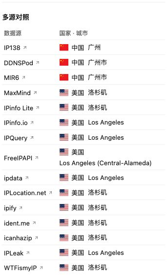
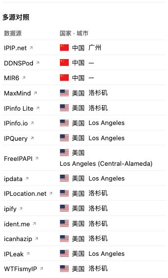
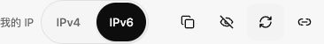
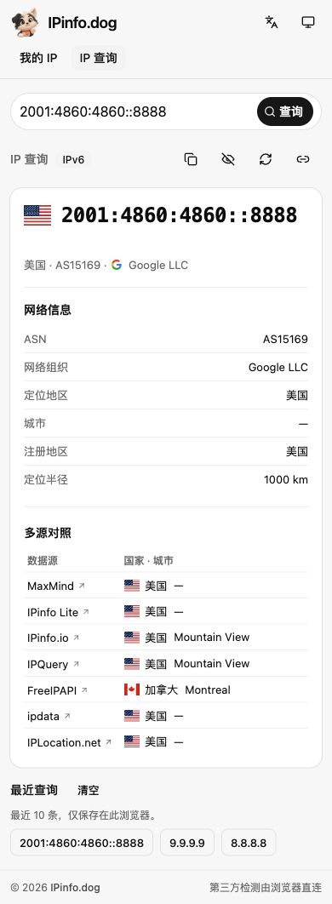

# 移动端内置浏览器复核

2026-11-17。用户取消真机复核后，另行要求使用内置浏览器重新验收正式站点。只复核现有页面，不修改应用、网络或部署，不把旧截图作为本轮证据。此前ADB未发现设备及取消记录保留；本轮不是原生真机验收。

## 结论

本轮未复现横向滚动、非预期位置跳动或可见成功回显协议混用。20组实际DOM审查通过：首页双协议六宽度12组、深色手机2组、公共IPv6独立查询六宽度6组。浏览器视口和临时主题已恢复。

## 操作与证据

1. **首页切换：正常。** 浅色320 /360 /390 /430 /768 /1440px逐一切换IPv4与IPv6。整页scrollWidth等于视口宽度，所有可见容器均无超过1px的内部横向溢出；每组栏目14px /600、列表13px /400、表头12px /500符合规范。主地址族、所选按钮与实际可见报告一致；共同来源的单元格横坐标与宽度一致，卡片顶边 /IP首行起点一致。截图：[IPv4来源](recheck-mobile-v4-table.jpg)、[IPv6来源](recheck-mobile-v6-table.jpg)、[切换器](recheck-mobile-switch.jpg)。
2. **显隐与刷新：正常。** 每组都进行了显示→隐藏→显示，主卡 /地址 /摘要 /对照区域 /工具栏以及各来源行矩形完全一致。IPv4刷新时切到已加载IPv6，再切回IPv4；IPv6刷新时反向切换，均未出现迟到结果串页。320px真实冷启动抓到detecting与ready两阶段，工具栏高度均102px、卡片顶边均223px、IP首行均239px。来源从骨架变为实际文本时内容高度可自然增长，不等于IP首行位移。390px IPv6完整地址两行、IPv4一行，下方内容正常相差30px；320px IPv6三行，属于完整显示的正常换行。
3. **多源归属与独立查询：正常。** 本轮IPIP.net返回IPv6，仅在IPv6页签出现；IP138返回IPv4，仅在IPv4页签出现。所有可从行提示读取到成功观测地址的回显，其地址族均匹配当前页签；加载或失败不伪造为另一协议成功。深色320 /390px也无溢出 /协议错配。固定公共IPv6的独立查询在六宽度均无横向溢出，未出现访客回显行。截图：[公共IPv6手机查询](recheck-public-v6-mobile.jpg)。不同来源返回国家城市差异保持原样，不能用地理差异推断协议混用。

## 验证边界

截图及实际DOM测量证明本轮内置浏览器、当前网络与当前内容的上述行为。没有强制双栈端点的传输协议，没有新增网络阻断、模拟失败或单栈 /NAT64测试；实际协议以成功返回地址族判断。来源网络失败 /单行重试的异常路径本轮未主动制造。没有执行原生iOS /Android、读屏、OS动态缩放或完整无障碍审查，不能据此宣称全部设备通过。

真实首页截图与脱敏测量仅在Git忽略的本地ops；公开图片为不含出口地址的控件 /来源表截图或固定公共查询样本。代码未改，本轮不重复单元 /lint /build、不重新部署、不自动推送GitHub。此前195项 /公网检查为前轮实现证据，不冒充本轮重新执行。

## 本轮截图

IPv4对照：

IPv6对照：

协议切换器：

固定公共IPv6独立查询：

