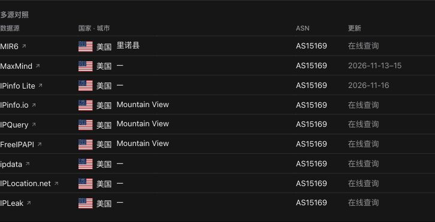

# 精简公共来源清单

2026-11-17。用户最新明确从公共清单统一删除不支持指定IP查询的源，不留能力说明。按同一comparison-catalog移除DDNSPod /ipify /ident.me /icanhazip /WTFismyIP，两页与骨架自然同步为9项；删除能力占位渲染分支及三语文案，注册项必须有指定目标能力。MIR6仍最前。首页内部备用探测用于取得自身IP，保留；只对公共清单中的回显结果补齐归属地，避免为已隐藏源额外查询。公共表格组件 /第三方浏览器直连 /本地MMDB /导航保持。

当前公共清单依次为MIR6 /MaxMind /IPinfo Lite /IPinfo.io /IPQuery /FreeIPAPI /ipdata /IPLocation.net /IPLeak。真实请求失败仍保留错误与重试；移除的是不支持指定IP的能力占位，不掩盖来源故障。

本地5项定点单元、lint /构建 /类型检查通过；发布镜像按既有流程执行201项单元及3项精简候选通过。已部署 **m1-15-source-trim-6aba94eab201** healthy。正式内置浏览器分别核对首页与固定8.8.8.8查询页390px：同9个来源ID、顺序一致、无能力占位、无可见容器或页面横向溢出。未重跑整套断点 /双协议矩阵、FPS或真机验收；不将本次定点检查扩大为这些范围通过。

源码包204文件与本地一致，排除私密材料。发布保护Caddy /两库 /定时更新器，回退保留前版；运维详细证据仅在本地ops归档。进度和规范已同步，未提交 /未推送。

